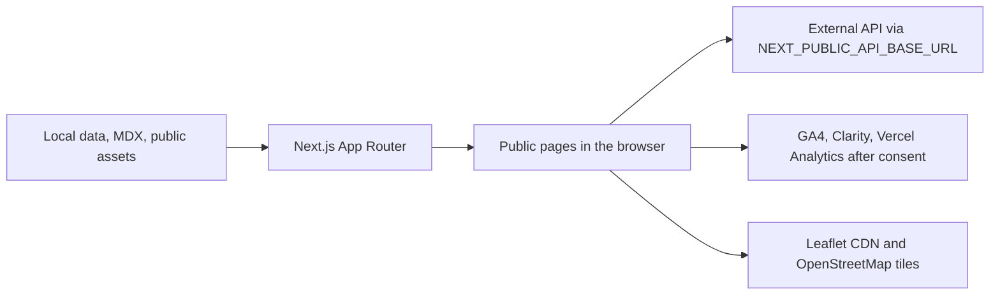

# Architecture

## Overview

This is one Next.js App Router application. Most pages are server-rendered or prerendered from source-controlled JavaScript and MDX. Client components provide navigation state, browser effects, forms, chatbot behavior, cookie consent, theme preference, and downloads. There are no `app/api` handlers, middleware, database clients, or authentication libraries.

## Module responsibilities

- `app/layout.jsx` owns global metadata, organization/website structured data, the French document language, viewport settings, global CSS, and `ClientLayout`.
- Route folders under `app/` own page composition and route-specific CSS. Dynamic blog and project segments implement `generateStaticParams` and metadata generation.
- `components/ClientLayout.jsx` wraps the public site with header/footer, scroll effects, chatbot, and cookie consent. It deliberately removes that chrome from `/business-card`.
- `components/layout/` contains header and footer; top-level component files contain reusable marketing sections. `components/chatbot/` and `components/devis/` isolate stateful workflows with CSS Modules.
- `data/` is the source of truth for structured, repository-local marketing records.
- `services/` presents a consistent access layer. Most modules return local data; `apiClient.js`, `contactService.js`, `chatbot.js`, and `devis.js` cross the external API boundary.
- `lib/posts.js` reads and parses `posts/*.mdx` on the server/build process. `lib/seo.js` centralizes production URLs and metadata builders. `lib/llms.mjs` catalogs content for generated public Markdown.
- `scripts/` contains build-time generation and post-build assertions.

The `@/*` path alias is configured in `jsconfig.json`, though current code mainly uses relative imports.

## Routing and rendering

The route tree follows `app/`. Server components are used unless a file declares `'use client'`. Local data pages can be rendered without a backend. Blog and project detail routes are enumerated at build time from the filesystem/data arrays; the sitemap uses the same sources plus the static route catalog in `lib/seo.js`.

`/saas-development` calls `permanentRedirect`. `app/not-found.jsx` supplies no-index 404 metadata. `/business-card` has its own no-index layout but still passes through the root layout and `ClientLayout`, which detects the pathname and suppresses shared chrome.

## State and browser storage

There is no global state library. Client components use React state and effects.

- Theme preference is stored as `theme` in local storage and applied through `data-theme` on the root element.
- The chatbot stores only `smartdex_chat_session_id` in local storage, validates it as a UUID, and keeps messages/quote results in component memory.
- Analytics consent is stored in the `smartdex_cookie_consent` cookie with a version and approximately 183-day maximum age.
- Quote access tokens and form payloads are kept in component/request state; they are not intentionally persisted by this code.

## Data fetching and API boundary

`services/apiClient.js` resolves relative paths against `NEXT_PUBLIC_API_BASE_URL` (fallback `http://127.0.0.1:8000`), adds JSON content type for request bodies, parses JSON responses, and throws `ApiError` for non-2xx status codes.

Implemented endpoints are:

| Method and path | Caller | Purpose |
| --- | --- | --- |
| `POST /api/contact/` | Contact form | Submit contact and privacy-version fields. |
| `POST /api/chatbot/chat/` | Chat widget | Send one message and optional conversation UUID. |
| `POST /api/devis/generate-from-chat/` | Chat widget | Generate a quote from user chat messages. |
| `POST /api/devis/requests/` | Quote form | Create a structured quote request. |
| `POST /api/devis/requests/{id}/generate/` | Quote service | Generate result using `X-Devis-Access-Token`. |
| `POST /api/devis/requests/{id}/generate/?format=pdf` or returned `pdf_url` | Quote UI | Download PDF using the same header. Legacy `token` query parameters are stripped. |

All of these calls originate in browser client components, so CORS, TLS, validation, rate limiting, storage, notifications, and authorization must be supplied by the external service. Their implementation is outside this repository.

## External integrations

- Google Analytics 4 and Microsoft Clarity scripts are injected only after accepted analytics consent. Their public IDs are constants in `lib/cookieConsent.js`.
- `@vercel/analytics` is rendered only after accepted consent.
- The contact map dynamically loads Leaflet 1.9.4 from `unpkg.com` and OpenStreetMap tiles.
- LinkedIn, telephone, email, and external website links are static outbound integrations.

## Adding functionality

- New public route: add `app/<route>/page.jsx`, use the SEO helper, then evaluate `indexableRoutes`, sitemap coverage, `scripts/seo-check.mjs`, and `lib/llms.mjs`.
- New blog article: add an MDX file with `title`, `description`, `date`, and optional `category`; update `data/blogServiceMap.js` only when it needs a primary service association.
- New portfolio item: add a complete record to `data/projects.js` and its local image/`IMAGE_MAP` entries where cards and details render it.
- New shared UI: place it under `components/`, reuse global tokens, and keep browser-only behavior behind a focused client boundary.
- New backend operation: add a service wrapper rather than fetching inside presentation markup; define safe error behavior and never expose a secret through `NEXT_PUBLIC_*`.
